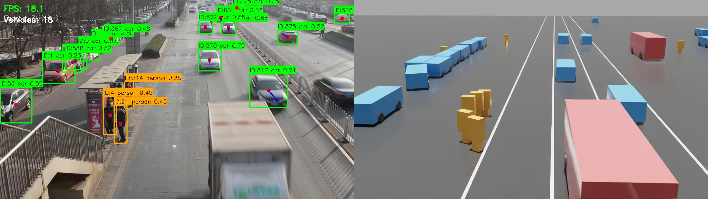
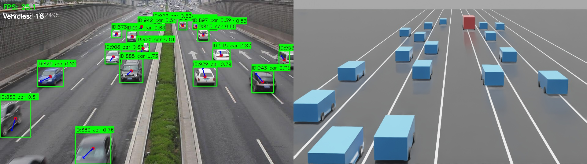
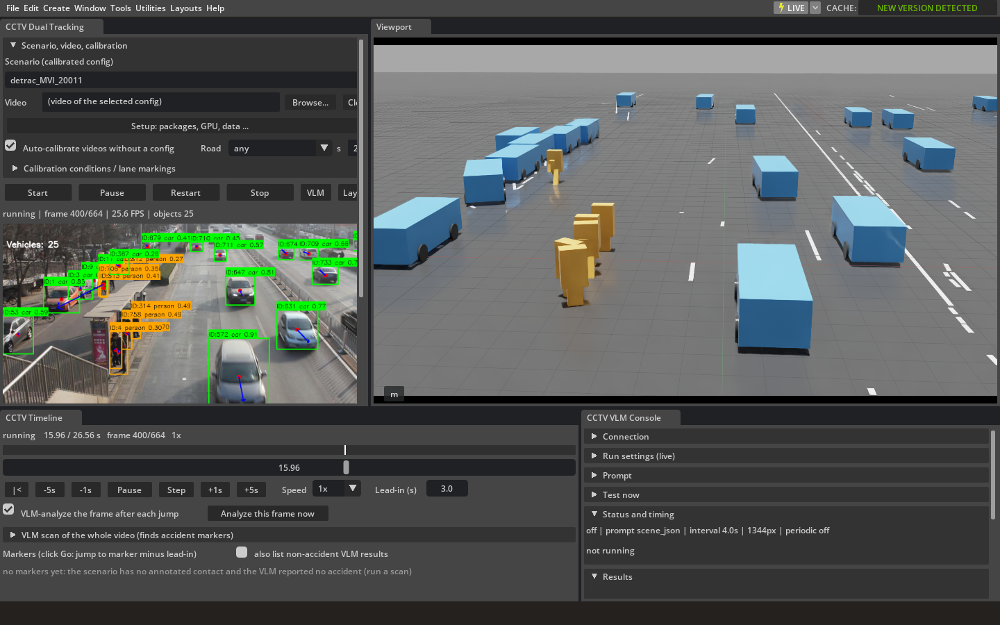
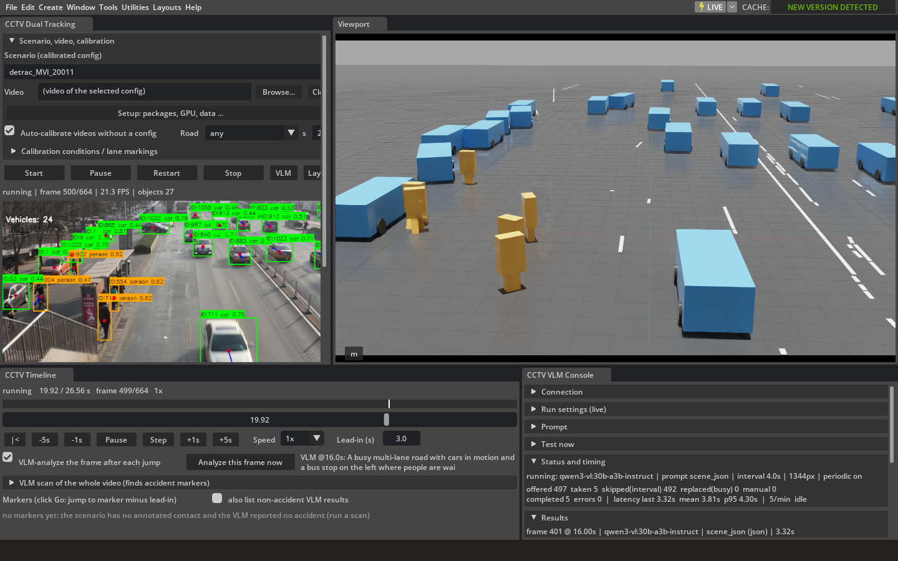
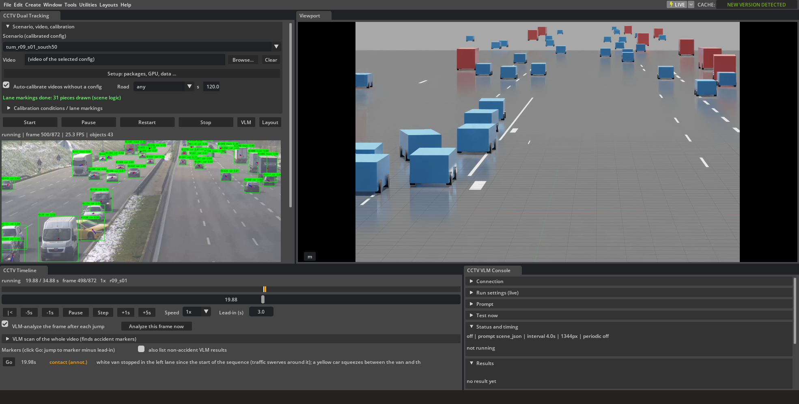

# 🚗 Hands-on Lab: Turning a CCTV Video into a 3D World

> **Today's mission**
> We take real road CCTV video, let an AI find the cars and people,
> and rebuild the very same scene inside a 3D world (NVIDIA Isaac Sim).
>
> ```
> CCTV video ──▶ AI (YOLO) finds cars ──▶ where on the road? ──▶ cars drive in the 3D world
> ```



---

## 📦 What we need

| Item | Why | On our machine |
|---|---|---|
| Computer with a GPU | The AI needs lots of fast math | DGX Spark (NVIDIA GB10) |
| Isaac Sim 5.1 | Draws the 3D world | `~/Desktop/Issac-sim-5.1` |
| Internet | To download code, videos, AI models | — |
| Lab scripts | One command per step | `~/AI_CCTV_PROJ/lecture/scripts/` |

> 💡 **Golden rule:** we never change Isaac Sim itself.
> Everything we add lives inside the project folder — delete the folder and the computer is back to how it was.
> No Docker, no pre-downloaded dataset needed: the scripts fetch everything.

Time: setup ≈ **6 minutes** (mostly downloading), each run ≈ **1–2 minutes**.

---

## Open a terminal

First time only, get the lab folder from GitHub (it sits next to the project, not inside it):

```bash
mkdir -p ~/AI_CCTV_PROJ && cd ~/AI_CCTV_PROJ
git clone https://github.com/omnyx2/cctv-isaac-reconstruction.git
cp -r cctv-isaac-reconstruction/lecture .
```

> 💡 Step 1 switches the project to the version this lab was tested with, which has no `lecture/`
> folder, so we work from the copy in `~/AI_CCTV_PROJ/lecture`.

```bash
cd ~/AI_CCTV_PROJ/lecture/scripts
```

> 🧑‍🏫 **Teacher tip:** run `./setup_all.sh` once before class (steps 0–4, ~6 min).
> In class you can then jump straight to **Step 5**.

---

## Step 0 — Look at our computer 🔍

```bash
./00_check_machine.sh
```

Only *looks*, installs nothing. You should see:
- `aarch64` → an ARM computer (same kind of chip as a phone!)
- `NVIDIA GB10` → the GPU
- `DISPLAY=:0` → we can open windows
- Isaac Sim version `5.1.0`

> ❓ **Quiz:** Why does the AI need a GPU, not just the CPU?
> → Finding cars needs millions of small calculations per picture.
>   A GPU does thousands of them **at the same time**.

---

## Step 1 — Get the code 📥

```bash
./01_get_code.sh
```

Copies the project from GitHub (`git clone https://github.com/omnyx2/cctv-isaac-reconstruction.git`),
then picks the **version this lab was tested with** (commit `9a4c346`; it already has the fixes for Step 6
and the VLM settings of Steps 7–8). Running it again changes nothing if that version is already there.

> 🧑‍🏫 Newer code on GitHub was **not** tested with this lab. To try it anyway: `PROJECT_COMMIT=<commit> ./01_get_code.sh`.

| Folder | Job |
|---|---|
| `perception/` | 👀 **Eyes** – finds cars and people in the video (YOLO) |
| `world/` | 🧠 **Brain** – turns screen pixels into road meters, smooths motion |
| `simulation/` | 🎮 **Hands** – moves the cars in Isaac Sim |
| `config/` | 📝 Settings per video (camera height, angle, lanes) |
| `main.py` | ▶️ Starts everything |

---

## Step 2 — Add the missing tools 🧰

```bash
./02_install_packages.sh
```

Isaac Sim already ships Python, numpy and torch. We add only four packages:

| Package | Role |
|---|---|
| `ultralytics` | YOLO – the car-finding AI |
| `lap` | ByteTrack – keeps "car #1" as car #1 in every frame |
| `polars` | Helper that ultralytics needs |
| `opencv-python` | Opens windows to show the video |

**Where do they go?** Only into the project's `.pydeps` folder.
`env.sh` sets `PYTHONPATH=.pydeps` so Python looks there too.

> 🕵️ **A real bug we hit**
> The first run started Isaac Sim, then crashed with:
> ```
> cv2.error: The function is not implemented. Rebuild the library with ... GTK+ ...
> ```
> Isaac Sim's own OpenCV is a **"headless" build – it cannot open windows**
> (Isaac Sim draws its own screen, so it never needed them).
> Installing a window-capable OpenCV into `.pydeps` fixed it.
> → **Read error messages carefully – the answer is often right there!**

Expected ending:
```
cv2         4.11.0 (can open windows: True )
torch       2.7.0+cu128 GPU: True
[ok] Packages ready
```

---

## Step 3 — Download videos and AI models 🎞️

```bash
./03_download_data.sh
```

| What | Size | Source |
|---|---|---|
| `yolov8n.pt` | 6 MB | Ultralytics – small, fast car finder |
| `yolo11s.pt` | 19 MB | Ultralytics – bigger, more accurate |
| MVI_20011 | 60 MB, 664 photos | UA-DETRAC – bus stop road, Beijing |
| MVI_40191 | 230 MB, 2,495 photos | UA-DETRAC – two-way expressway |

> 💡 **Clever trick:** the original dataset is **one 5.6 GB zip file**, but we need only two videos.
> `remote_zip.py` reads just the zip's *table of contents* (stored at the end of the file),
> then downloads **only the photos we need** using HTTP "Range" requests.
> Like reading a library catalogue and borrowing one book instead of carrying home the whole library 📚

> ⚠️ UA-DETRAC is licensed CC BY 4.0 – fine for class, just credit the source.

If the download stops, simply run it again: finished photos are skipped.

### More data (optional) ➕

```bash
./03_download_data.sh --list                      # what can be downloaded
./03_download_data.sh MVI_39761 40131             # any of the 60 UA-DETRAC videos ("MVI_" optional)
./03_download_data.sh --detrac-all                # all 60 (~5.6 GB)
./03_download_data.sh --tum-scenes                # 4 real highway accidents, 35 s each (~1.1 GB)
./03_download_data.sh --tum r09_s10 north50       # one whole TUM camera (~3,000 photos, ~1 GB)
./03_download_data.sh --tum-configs               # every TUM camera a config/auto_*.yaml uses (~15 GB)
```

| Data | Ready to play in Isaac Sim | Source |
|---|---|---|
| UA-DETRAC MVI_20011, MVI_40191 | yes (`config/detrac_*.yaml`) | Hugging Face zip, CC BY 4.0 |
| other UA-DETRAC videos | no config yet: the extension can try to calibrate a picked video | same zip |
| TUM accident scenes | yes (`config/tum_r09_*.yaml`): the crash happens 20 s into each clip | TUM Traffic Accid3nD, Nextcloud share, **CC BY-NC-SA 4.0 (non-commercial)** |
| TUM full cameras | yes, for the cameras with a `config/auto_r09_*.yaml` | same share |

TUM is five ~9 GB zips; `tum_download.py` uses the same Range trick and fetches only the photos asked for
(a camera can be split over two zips, so all five tables of contents are read first, ~30 s).
Add `--labels` to also get the dataset's 3D labels (only the evaluation tools need them).
The share answers each request slowly, so 32 photos are fetched in parallel: a scene takes about 1–3 minutes.

> 🖥️ **On our DGX Spark: same commands, from the shared folder.** Every pod sees `/mnt/public`
> (`~/Public`). The videos and the VLMs were downloaded there once, so `./03_download_data.sh` and
> `./07_vlm_setup.sh` find them there and copy instead of downloading (seconds, not minutes):
> ```bash
> ./03_download_data.sh                          # the lab's two videos
> ./03_download_data.sh MVI_39761 40131 39031    # any of the 80 shared videos (60 train + 20 test)
> ./03_download_data.sh --detrac-all             # all 80 (~8 GB, about a second)
> ./09_more_scenes.sh                            # the TUM accident clips (instead of --tum-scenes, see More hands-on)
> ```
> 🧑‍🏫 Filling the shared folder (once, by the teacher): `./03_spark_public.sh fill` → `/mnt/public/CCTV_recon_dL`
> (UA-DETRAC packed as one .tar per video, the 5 TUM Traffic Accid3nD zips, the 5 VLMs), then `./09_more_scenes.sh fill`.
> Other computers run the same two scripts and download from the internet as usual.

---

## Step 4 — Health check ✅

```bash
./04_check_env.sh
```

Runs the project's own checker (`tools/check_env.py`). These must be `[ok]`:

```
[ok] ultralytics
[ok] lap
[ok] torch                        2.7.0+cu128, CUDA 12.8, available=True
[ok] GPU kernels for this GPU     NVIDIA GB10 sm_121
[ok] CUDA matmul                  ran on the GPU
[ok] YOLO inference
```

**`[!!]` is OK for these** (not used today):
`TUMTraf-Accid3nD` (real accident videos, optional: `./03_download_data.sh --tum-scenes`),
`data/cache` (made automatically), `Ollama` (we switch it on in Step 7).

> 💡 Good news we discovered here: Isaac Sim's own torch already runs on the GB10 GPU,
> so no extra Python environment is needed.

---

## Step 5 — Run it! 🚀

```bash
./05_run.sh            # bus stop road (MVI_20011)
./05_run.sh 40191      # expressway (MVI_40191)
```

Isaac Sim needs **20–30 seconds** to start (the screen may freeze – that's normal).
Then you see the **real video** and the **3D world**.

| Key | Action |
|---|---|
| `Space` | Pause / resume |
| `R` | Restart |
| `Q` | Quit |

### What to look for 👀

- **Left (real video):** `ID:517 car 0.71` = "car number **517**, AI is **71 %** sure it's a car".
- **Blue line** in a box = the direction the car is moving.
- **Right (3D):** blue = car, red = bus/truck, yellow = person.
- A car hidden behind a bus comes back with the **same ID** – that's tracking (ByteTrack)!
- `FPS` (top-left): frames per second. We measured **18 FPS** (MVI_20011) and **25 FPS = real time** (MVI_40191).



### Save pictures for your report

```bash
./05_run.sh 20011 --save-dir ~/my_snaps --save-every 100
```
Every 100 frames, saves the real video and the 3D world side by side.

---

## Step 6 — Inside the Isaac Sim window 🏗️

```bash
./06_run_extension.sh            # bus stop road
./06_run_extension.sh 40191      # expressway
```

The same project also runs as an **Isaac Sim extension**: no OpenCV windows, everything
lives inside Isaac Sim.

1. Wait for Isaac Sim to open (about 30 s). The windows dock around the 3D viewport.
   Wait until **CCTV Dual Tracking** says `ready: detrac_MVI_20011 (first frame and scene shown; Start to replay)`.
2. In **CCTV Dual Tracking** press **Start**. The **Scenario** list shows only the videos we downloaded
   (`detrac_MVI_20011`, `detrac_MVI_40191`); pick one there to switch.
3. In **CCTV Timeline** try `-5s`, `+5s`, `Step` and `Speed` (slow motion!).



We measured **25.6 FPS** here, with all 664 frames played to the end.

> 🕵️ **Detective story: three bugs in a row**
> Getting this mode to work on Linux took three fixes. Each one taught us something:
>
> | # | What we saw | Why | Fix |
> |---|---|---|---|
> | 1 | YOLO helper started the **system Python 3.12** | Inside Isaac Sim, `sys.executable` points at `/usr/bin/python3` | Code: pick Isaac Sim's Python from `sys.prefix` (`session.py`) |
> | 2 | `No module named 'numpy'` | Isaac Sim finds numpy through its extension system, not `sys.path`; a new process copies only `sys.path` | Code: put those folders on `sys.path` while the helper starts (`perception_worker.py`) |
> | 3 | `No module named 'ultralytics'` | Isaac Sim **ignores `PYTHONPATH`** by default, so it never saw `.pydeps` | Start option `Py_IgnoreEnvironmentFlag=false` (in `06_run_extension.sh`) |
>
> Lesson: when a program starts *another* program, the second one doesn't automatically
> know everything the first one knows!

**Unattended run (teacher):** play to the end, save pictures, then close by itself:
```bash
./06_run_extension.sh 20011 \
  --/exts/cctv.dual_tracking/autostart_config=config/detrac_MVI_20011.yaml \
  --/exts/cctv.dual_tracking/snapshot_dir=$HOME/ext_snaps \
  --/exts/cctv.dual_tracking/quit_on_finish=true
```

---

## Step 7 — Wake up the VLM 🗣️

```bash
./07_vlm_setup.sh      # qwen3-vl:30b-a3b-instruct, 4-bit (19 GB download, ~20 GB memory)
```

Memory tight? Use the smaller model (6 GB) for both step 7 and step 8:
```bash
export VLM_MODEL=qwen2.5vl:7b
./07_vlm_setup.sh
```

> 💡 **Which model and why?** We tested every vision model we had on this DGX Spark
> (see **🏁 Which VLM?** below). The winner is **qwen3-vl 30B-A3B
> in 4-bit (q4)**: the most correct answers and still fast. "30B-A3B" = 30 billion numbers in total,
> but only 3 billion work on each word, so it answers like a small model. "4-bit" = each number is
> squeezed into 4 bits, so the model fits in 19 GB instead of ~60 GB. The model is set once in
> `scripts/env.sh` (`VLM_MODEL`); steps 7 and 8 both use it.

Want to compare? `./07_vlm_setup.sh all` downloads 5 models from 5 families (`VLM_MODELS` in `env.sh`),
then pick one in the VLM console (Step 8, **Connection → model**):

| Model | Family | Download | Notes |
|---|---|---|---|
| `qwen3-vl:30b-a3b-instruct` | Qwen (Alibaba) | 19 GB | default, best in our test |
| `qwen2.5vl:7b` | Qwen (Alibaba) | 6 GB | smaller, fast |
| `gemma4:e2b` | Gemma (Google) | 7 GB | tiny brain, fastest, misses crashes |
| `llama3.2-vision:11b` | Llama (Meta) | 8 GB | not in our benchmark |
| `mistral-small3.2:24b` | Mistral | 15 GB | not in our benchmark |

YOLO can only draw boxes and say "car". A **VLM (vision-language model)** looks at the
whole picture and **answers in words**: "Heavy traffic, people waiting at the bus stop".

What the script does:
1. Starts the **Ollama** server (the program that runs AI models on our own computer, no internet needed after download).
   It keeps one model in memory at a time and a short memory (context) of 8,192 tokens: without that,
   qwen3-vl reserves room for 262,144 tokens and takes **45 GB instead of 19 GB**.
2. Downloads the model (only the first time).
3. Asks the VLM about 3 frames of MVI_20011 and saves the answers to `data/results/vlm/lecture_test.jsonl`.

What we got on our DGX Spark (qwen3-vl:30b-a3b-instruct, 2026-10-11):

| Video time | Answer time | The VLM said |
|---|---|---|
| 0 s | **7.3 s** | "A high-angle view of a multi-lane road with moderate traffic, a bus stop with people waiting, and a pedestrian crossing." |
| 10 s | 2.2 s | "A busy multi-lane road with traffic moving in both directions, a bus stop with people waiting on the left, and a pedestrian crossing the road in the distance." |
| 20 s | 2.1 s | "A multi-lane road with moderate traffic, a bus stop with waiting passengers, and a pedestrian crossing in the foreground." |

All three answers say `accident: false` and `people_on_road: true`. Memory used by the model: **19 GB**.

> ❓ **Why was the first answer 3× slower?** The 19 GB model had to be loaded into GPU memory first.
>
> 🔎 **Compare:** the small qwen2.5vl:7b said `people_on_road: true` at 0 s but `false` at 10 s for
> almost the same scene. The bigger model is more consistent, but it is still a helpful describer,
> not a perfect measuring tool.

---

## Step 8 — VLM Playground 🎮 (no new script: Step 6 + the console window)

The VLM server from Step 7 keeps running in the background. Now open Isaac Sim exactly like Step 6:

```bash
./06_run_extension.sh            # bus stop road
./06_run_extension.sh 40191      # expressway
```



The **CCTV VLM Console** window (bottom right) was already there in Step 6. It is not the VLM
itself; it is the window that *asks* the server and shows the answers.

1. **Connection** → `Check / refresh`. The model from `env.sh` (`qwen3-vl:30b-a3b-instruct`) is already
   selected; you can pick another one from the list.
2. **Run settings** → tick **periodic** (the VLM looks every few seconds).
3. Press **Start** in CCTV Dual Tracking. Every few seconds an answer appears in **Results**.

| Console section | What you can do |
|---|---|
| **Connection** | `Check / refresh`, then pick a model from the list |
| **Run settings** | periodic on/off, **interval** (s), **image long side** (px), temperature, JSON answer |
| **Prompt** | presets `scene_json`, `accident_yesno`, `describe`, or **your own question** → `Apply prompt` |
| **Test now** | `Analyze current replay frame` or `Analyze image file...` (any photo!) |
| **Status and timing** | how long each answer took (last / mean / p95) |
| **Results** | summary, parsed fields (red = accident), raw answer, history |

### 🧪 Missions

1. **Read the robot's mind.** Watch `Results` for a minute.
   Does the VLM notice the **people at the bus stop** (`people_on_road`)? Is it right?
2. **YOLO vs VLM.** The top-left of the video says `Vehicles: 25`.
   Ask the VLM: *"How many cars can you see? Answer with one number."*
   (turn **JSON answer off** for free-text prompts, then `Apply prompt`). Who is closer?
3. **Change the question.** Try the presets one by one:
   `describe` (long story), `accident_yesno` (yes/no first), `scene_json` (machine-readable).
   Which one is easiest for a *program* to use? Which is easiest for a *person*?
4. **Speak Korean!** Your own prompt: *"이 CCTV 장면을 한국어로 두 문장으로 설명해줘."*
5. **Speed vs detail.** Set image long side to **448** px, then **1344** px.
   Compare `latency` in Status and timing. Does the answer change?
6. **Bring your own picture.** `Analyze image file...` → pick any road photo.
7. **Accident hunter (Timeline window).** `VLM scan of the whole video` checks frames across the video
   and adds **markers** where it thinks there was an accident. (UA-DETRAC has no accidents,
   so a good model should find none – does yours?)

> ⚠️ **AI can be wrong, and confidently wrong.** The VLM sometimes "sees" things that are not there
> (this is called a *hallucination*). That's why this project lets the VLM *describe* the scene,
> while the cars in the 3D world come only from YOLO + physics.

> 🧑‍🏫 To keep every answer for later discussion, start with
> `./06_run_extension.sh 20011 --/exts/cctv.dual_tracking/vlm_log=true`: answers go to
> `data/results/vlm/extension_log.jsonl`.
> Measured here (2026-10-11, qwen3-vl:30b-a3b-instruct q4, an answer every 4 s): **4–5 s per answer**
> (2.6–6.3 s over 3 runs), 6–7 answers on the bus stop video, 23 on the expressway, 0 errors,
> no accident wrongly reported, and at least 76 GB of memory always free.
> Replay speed: **25.4 FPS with the VLM off, 18–21 FPS with it on.**
> (The smaller qwen2.5vl:7b took ≈5.3 s per answer and gave 18.0 FPS.) The VLM never makes the video
> wait (see below); the drop is most likely the Ollama server and YOLO sharing the same GB10 GPU.
> (The first run, with lane markings not yet cached, also re-ran YOLO over the whole video in the
> background and showed only ≈11 FPS – that was the lane-marking job, not the VLM.)

> ❓ **Where does the VLM actually run?** Three separate pieces:
> ```
>  Ollama server  (separate program, started by step 7, runs outside Isaac Sim)
>        ▲ HTTP
>  VLM worker thread (inside Isaac Sim) ◀── a slot holding only the newest frame ◀── replay loop
>        │
>        ▼
>  CCTV VLM Console window  (shows the answers; it is a client, not the server)
> ```
> The replay loop just drops the newest frame into the slot and keeps going. Frames that arrive
> while the VLM is still thinking are skipped, so YOLO and the video never wait for the VLM.

---

## 🏁 Which VLM? Our test on the DGX Spark

Before class we asked every vision model we had the same questions about **58 pictures**:
32 CCTV frames (no accident), 18 real crash photos, and 8 tricky photos that *look* like accidents but are not.
Tool: `lecture/vlm_bench/vlm_bench.py`, full report: `lecture/vlm_bench/results/REPORT.md`.

| Model | Memory | Answer speed | Accident yes/no right | Crashes found (of 18) | False alarms | Counting cars right |
|---|---|---|---|---|---|---|
| gemma4:e2b | 1.8 GB | 157 words/s | 78 % | 5 | 0 | 47 % |
| qwen2.5vl:7b | 5.9 GB | 59 words/s | 93 % | 16 | 0 | **75 %** |
| **qwen3-vl:30b-a3b (q4)** ⭐ | 19.8 GB | 112 words/s | **100 %** | **17** | 0 | 69 % |
| qwen3-vl:30b-a3b (q8) | 33.5 GB | 71 words/s | 98 % | 17 | 0 | 69 % |

("words/s" = tokens per second, roughly words.) What we learned:
- ⭐ **q4 is our pick:** the best accident answers, and faster than q8.
- **Bigger is not always better:** q8 (8-bit) uses 70 % more memory than q4 and was *not* more correct.
- **The tiny model is fast but misses crashes:** gemma4 found only 5 of 18.
- **Counting is hard for every VLM:** none got the car count in range more than 75 % of the time.
  That is why the 3D world uses YOLO's boxes, not the VLM's numbers.

> ⚠️ **Too big for this machine.** qwen3-vl:32b (dense) and qwen2.5vl:72b both used up the memory while being tested
> and **the whole desktop shut down** (DGX Spark: CPU and GPU share one ~120 GB memory, and the
> container's real limit is ~117 GB). We do not run 72B or bigger models here (llama3.2-vision:90b,
> llama4:scout were not tried). Rule of thumb: the model plus Isaac Sim must leave plenty of memory free.

---

## 🧠 How does it work?

```
 1. 📷 Read video       perception/video_player.py   read photos one by one
 2. 🎯 Find (YOLO)      perception/yolo_tracker.py   boxes around cars and people
 3. 🔗 Track            ByteTrack                    same car keeps the same number
 4. 📐 Pixels → meters  world/camera.py              screen point → road point
 5. 🧹 Smooth           world/dynamic_logic.py       remove jitter (Kalman filter)
 6. 🚲 Drive            world/vehicle_dynamics.py    move like a real car (bicycle model)
 7. 🎮 Draw 3D          simulation/                  place cars in Isaac Sim
```

> ❓ **Why "drive" the car with a bicycle model instead of teleporting it to the AI's guess?**
> The AI is a little wrong sometimes. Teleporting would make cars slide sideways or spin
> on the spot – impossible for a real car. Allowing only real-car moves makes the 3D world believable.

> ❓ **How do we know meters from pixels?**
> A lane is **3.5 m** wide. Four points on the lane lines (pixels) + their real distances (meters)
> let the computer work out "this pixel is X meters down the road".
> Look for `calibration_points` in `config/detrac_MVI_20011.yaml`.

---

## 🛠️ Troubleshooting

| Problem | Fix |
|---|---|
| `Isaac Sim not found` | `export ISAAC_SIM=<folder with isaac-sim.sh>` and retry |
| `cv2.error ... not implemented` | Step 2 missing → `./02_install_packages.sh` |
| `Video not found` | Step 3 missing → `./03_download_data.sh` |
| Isaac Sim says `start failed: ... Video not found: .../TUMTraf-Accid3nD/...` | An old project copy listed scenarios we did not download. Close Isaac Sim, run `./01_get_code.sh` (updates the fixes), start again |
| VLM console uses another model than `qwen3-vl:30b-a3b-instruct` | **Connection** → pick it in the model list (the list shows every model you downloaded) |
| Download stopped | Run it again – it continues where it stopped |
| Screen frozen ~30 s | Isaac Sim is starting – wait |
| `There was an error running python` at exit | Isaac Sim's shutdown message – fine if the video played to the end |
| `Could not import system rclpy`, `leaked semaphore objects` | Harmless messages from Isaac Sim (ROS bridge / shutdown) |
| Red `Lane markings failed: no lane markings found` (Step 6/8) | Expected: we use the new scene-logic lane finder on purpose; it finds no paint in these short, busy videos. The replay, tracking, VLM and the main lane lines still work |
| `torch ... available=False` | GPU driver problem → check `nvidia-smi` |
| VLM console says *unavailable* | Ollama is off → `./07_vlm_setup.sh` |
| VLM answers take > 10 s | First answer loads the model; later ones are faster. Lower *image long side* |
| `ollama ps` shows the model at 45 GB, context 262144 | Ollama was started some other way. `pkill -f "ollama serve"`, then `./07_vlm_setup.sh` (starts it with an 8k context) |
| Memory tight / want something lighter | `export VLM_MODEL=qwen2.5vl:7b` then steps 7 and 8 (6 GB) |
| Isaac Sim asks "Would you like to save this stage?" | `Don't Save` (the scene is rebuilt every run; `06_run_extension.sh` already skips this on quit) |

## 🧹 Undo everything

```bash
rm -rf ~/AI_CCTV_PROJ/cctv-isaac-reconstruction/.pydeps   # only the added packages
rm -rf ~/AI_CCTV_PROJ/cctv-isaac-reconstruction           # the whole project
```
Isaac Sim (`~/Desktop/Issac-sim-5.1`) was never changed.

VLM (only if you want the disk space back):
```bash
pkill -f "ollama serve"                # stop the Ollama server started by step 7
ollama rm qwen3-vl:30b-a3b-instruct    # delete the 19 GB model
ollama rm qwen2.5vl:7b                 # and the 6 GB one, if you pulled it
```

---

## 🧪 More hands-on — real accidents and more cameras (appendix)

Finished early? Our two Beijing videos have **no accidents**. The **TUM Traffic Accid3nD** dataset
(Technical University of Munich) filmed a German motorway with fixed cameras and caught **real crashes**.
On our DGX Spark it is already in the shared folder; copy it to your computer:

```bash
./09_more_scenes.sh          # the accident clips (up to 35 s: 20 s before the crash, 15 s after; 1.1 GB, ~1 min)
./09_more_scenes.sh all      # ... and 13 full camera recordings (2 min each; 8 GB, ~4 min)
./09_more_scenes.sh list     # what can I play now?
```
Not on the DGX Spark (no shared folder)? Download the same clips from the internet instead:
`./03_download_data.sh --tum-scenes` (~1.1 GB, see **More data** in Step 3), then `./09_more_scenes.sh list`.

Then open one, exactly like Step 6 (or pick it in the **Scenario** list of the CCTV window):

```bash
./06_run_extension.sh tum_r09_s01_south50     # a car squeezes past a stopped van and hits it
```



> ⚠️ Spoiler: the **CCTV Timeline** lists a `contact (annot.)` marker with the exact crash time.
> For Mission 1, don't look at the Markers list until you have your own answer!

| Name | What it is |
|---|---|
| `detrac_MVI_20011`, `detrac_MVI_40191` | our two Beijing videos (Step 3) |
| `tum_r09_s01_south16`, `tum_r09_s01_south50` | the **same crash** seen by two lenses (16 mm wide, 50 mm zoomed) |
| `tum_r09_s02_north50` | a van's trailer starts swaying, the van crosses to the shoulder and **overturns** |
| `tum_r09_s03_north50` | slow traffic: a dark car hits the side of a white taxi |
| `auto_r09_...` (with `all`) | whole recordings; the camera was measured **automatically** from the lane paint |

Each accident clip comes with `scene.yaml` (what happened, the moment of contact) in
`data/datasets/TUMTraf-Accid3nD/accident_scenes/<name>/`. Read it **after** the missions!

### 🧪 Missions
1. **Crash detective.** Play a `tum_` clip. When do *you* see the crash? Write down the time
   (CCTV Timeline). Then check `scene.yaml`: were you right?
2. **Does the 3D world crash too?** Watch the 3D cars at the moment of contact. YOLO + physics only see
   boxes: do the 3D cars touch, jump, or pass through each other? Why?
3. **Ask the VLM.** Prompt preset `accident_yesno`. Pause before the crash and again a few seconds
   after it: does the answer change? Then **Timeline → VLM scan of the whole video**: is the marker near the crash?
4. **Two lenses, one crash.** `south16` vs `south50`: which one counts more cars? Which one is easier
   for the VLM? (Zoom = bigger cars but a smaller piece of road.)
5. **VLM tournament.** `./07_vlm_setup.sh all`, then in the console switch models on the **same paused
   frame**. Which model sees the crash? Which one is fastest? Compare with **🏁 Which VLM?** above.

> ⚠️ TUM Traffic Accid3nD is licensed **CC BY-NC-SA 4.0**: fine for class, not for selling;
> credit *TU Munich, accident-dataset.github.io*. The photos are big (1920×1200) and YOLO uses the larger
> model here, so the replay is slower than the Beijing videos.

> 🧑‍🏫 Measured here (2026-10-13): `tum_r09_s01_south50` 872 frames at **25 FPS**, 31 lane-paint pieces found,
> exit 0; the full recording `auto_r09_s10_s040_camera_basler_north_50mm` 3,000 frames, exit 0.

> 🧑‍🏫 **Teacher, once:** `./03_spark_public.sh fill` (all datasets + 5 VLMs → `/mnt/public/CCTV_recon_dL`),
> then `./09_more_scenes.sh fill` (cuts the 4 accident clips out of the zips, ~3 min).
> TUM stays as 5 zips in the shared folder: it writes small files slowly (~30 photos/s; unpacking all 223,000
> would take 2 hours), so `09_more_scenes.sh` unpacks only the cameras asked for on each computer's own disk (~400 photos/s).
> Students only copy, so the class never downloads from the internet at the same time.

---

## 📋 Teacher's appendix — what was actually done, in order

1. `git clone` → 404 at first (repository private); worked after it was made public.
2. Machine survey: DGX Spark (aarch64, GB10, CUDA 13.0), no Docker, Isaac Sim 5.1 at `~/Desktop/Issac-sim-5.1`.
3. Read `README.md`, `requirements-isaac.txt`, `tools/setup_spark.sh` to learn what's needed.
4. Isaac Sim's Python already had numpy 1.26, cv2 (headless), torch 2.7 cu128; **missing: ultralytics, lap, polars**.
5. Datasets are not in git → found a UA-DETRAC mirror on Hugging Face (5.6 GB zip) and
   wrote `remote_zip.py` to extract only the needed sequences.
6. Installed packages with `pip --target .pydeps` (Isaac Sim untouched; duplicate numpy removed).
7. `check_env.py`: Isaac Sim's torch runs on GB10 (sm_121) → no separate venv needed.
8. YOLO weights from the Ultralytics GitHub release.
9. Run 1 of `main.py`: headless-OpenCV error → added `opencv-python` (Qt GUI) to `.pydeps`.
10. Run 2: MVI_20011 all 664 frames (≈18 FPS); MVI_40191 all 2,495 frames (≈25 FPS). Exit code 0.
11. Extension mode, three fixes (see Step 6): Isaac Sim's Python picked from `sys.prefix`
    (`exts/cctv.dual_tracking/cctv/dual_tracking/session.py`, `setup_env.py`), extension package
    folders on `sys.path` while the YOLO process starts (`perception/perception_worker.py`), and
    `Py_IgnoreEnvironmentFlag=false` so Isaac Sim reads `PYTHONPATH`. Result: 664 frames at 25.6 FPS.
12. Re-checked `05_run.sh` after the code change: still plays all 664 frames.
13. VLM: Ollama was already installed for the user (only `gemma4:e2b` pulled, server off).
    `07_vlm_setup.sh` starts `ollama serve`, pulls `qwen2.5vl:7b` (6 GB) and tests 3 frames
    with `tools/vlm_analyze.py`. Step 8 = step 6 + periodic analysis on (tested with `vlm_periodic=true`, `vlm_log=true`):
    7 answers in one replay, 0 errors. (A separate `08_vlm_playground.sh` was removed: it started nothing new.)
14. Full re-test from an empty folder with `setup_all.sh`: **5 min 44 s**, all needed checks `[ok]`.
15. VLM benchmark (`lecture/vlm_bench/`, 58 labelled pictures, 5 tasks). Measured: gemma4:e2b, qwen2.5vl:7b,
    qwen3-vl:30b-a3b q4 and q8. qwen3-vl:32b and qwen2.5vl:72b ran the container out of memory (the whole
    desktop restarted, twice), so models of that size are not used on this machine. The memory guard
    (`tools/mem_guard.sh`) now watches the container's cgroup limit, not only `/proc/meminfo`.
16. Default VLM switched to **qwen3-vl:30b-a3b-instruct (q4)**: `VLM_MODEL` in `env.sh`, used by step 7 and,
    through a new extension setting `vlm_model`, by step 8. Ollama gets an 8k context
    (`OLLAMA_CONTEXT_LENGTH=8192` in step 7, `num_ctx` in `perception/vlm/client.py`): 19 GB instead of 45 GB.
17. Re-check (2026-10-11): step 7 → 3 answers (7.3 / 2.2 / 2.1 s); step 8 unattended → 664 frames, 7 answers,
    0 errors, ≈20 FPS. The unattended quit hung on "Would you like to save this stage?" → added
    `/app/file/ignoreUnsavedOnExit=true` to `06_run_extension.sh`; re-run quit by itself in 49 s.
18. Our code fixes existed only in the local copy, so a fresh clone would fail in Step 6. Now `01_get_code.sh`
    checks out the tested commit `b02b0b5` and applies `lecture/patches/lab-fixes.patch` (6 files).
19. **Full re-run as a student (2026-10-11), new empty folder, only `lecture/` copied:** `setup_all.sh` 5 min 57 s,
    all needed checks `[ok]`; Step 5 both videos exit 0 (≈20 / ≈23 FPS); Step 6 both videos to the end
    (25.4 FPS), Isaac Sim quit by itself; Step 7 same answers as above (7.4 / 2.3 / 2.2 s, 19 GB);
    Step 8 both videos: 6 and 23 VLM answers, 0 errors, 19.0 / 18.4 FPS, at least 76 GB memory free.
20. Typing `./06_run_extension.sh` by hand (not the unattended run) showed two traps: the Scenario list offered all
    18 configs, and 16 of them (TUMTraf / `auto_*`) fail with "Video not found"; and in a fresh folder the
    "CCTV Setup" window covered the viewport. Fixes: the list shows only configs whose video exists
    (`session.py`, in the patch), and `06_run_extension.sh` passes `setup_ok=true`. `01_get_code.sh` now
    stashes older fixes before applying the new patch, so existing project copies update too.
21. GitHub got the scene-logic camera calibration and lane paint (17 commits after `b02b0b5`). Merged into our
    fixes on branch `lab-fixes` (only conflict: `runnable_configs`, upstream made the same fix; took theirs).
    The lab now pins `f1d0ebc`; `lab-fixes.patch` holds the 4 fixes upstream does not have. Re-run on the new code:
    Steps 5/6 both videos exit 0 with the same tracking numbers as before, Step 7 the same answers, Step 8
    6 / 25 answers at ≈3.8 s, 0 errors, ≥80 GB free. Difference: the new lane-paint finder draws 0 (MVI_20011) /
    1 (MVI_40191) markings, the old one 55, and the panel shows "Lane markings failed". Decision (2026-10-11): keep
    the new method. The old lane cache on the teacher machine was moved to `data/cache/lanes_old_extractor/` so
    the teacher sees what the students see.
22. PR #1 (`lab-fixes`) merged into GitHub master as `64b5e51` (2026-10-11): the lab fixes and
    `LAB_FIXES_REPORT.md` are now upstream. `01_get_code.sh` pins `64b5e51` and applies no patch any more;
    `lecture/patches/` was removed. A project folder that still has the old patch applied as local changes
    gets them stashed (`git stash list`) before the checkout.
23. GitHub master moved on to `9a4c346` (visibility logic: night/twilight/haze choose the calibration work;
    traffic logic: congested windows are left out of the lane paint; PR #1 merged in). No new packages, our
    fixes unchanged. Re-run 2026-10-11: Step 5 both videos exit 0; Step 6 both videos exit 0 with the same
    world-model counters as before; Step 8 (MVI_20011, VLM on) 6 answers at 2.3–4.3 s, 0 errors. One of two
    VLM runs logged a PhysX "Failed to create simulation view" at startup and restarted the replay once; the
    rerun was clean. `01_get_code.sh` pins `9a4c346`.
